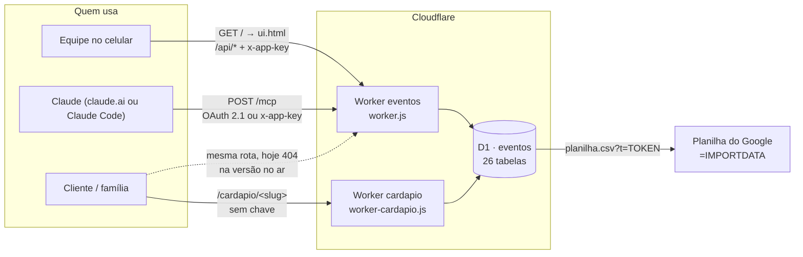

# Controle de Eventos · Desbravando UTV — Arquitetura e funcionamento

> Escrito em 09/09/2026 para uma pessoa entender o sistema **sozinha**, sem quem o construiu
> por perto. Cobre da estrutura de arquivos ao que acontece em cada requisição, em cada tela e
> em cada comando. Onde o código tem uma decisão que não é óbvia, o motivo está no comentário
> do próprio arquivo; aqui fica o mapa que liga tudo.
>
> O que este documento **não** é: a vitrine (isso é o [README.md](../README.md)) nem o guia de
> quem vai mexer com o Claude (isso é o [CLAUDE.md](../CLAUDE.md)). Este é o manual do
> funcionamento.
>
> **Atenção antes de qualquer deploy:** existem **duas linhas de código** deste sistema. O que
> está no ar hoje não foi publicado deste repositório. Leia a seção 11 antes de rodar
> `npx wrangler deploy`.

---

## 0 · Como ler

Se você tem dez minutos, leia as seções 1, 2 e 16. Se vai mexer na API ou no banco, 3 a 7.
Se vai mexer na interface, 5. Se vai mexer nos formulários públicos, 8 e 11. Se vai mexer no
conector do Claude, 9. A seção 14 tem as receitas prontas; a 15 é o vocabulário; a 17 é o que
quebra se você esquecer.

---

## 1 · O sistema em um parágrafo

Um **Cloudflare Worker** (`worker.js`, JavaScript puro, sem framework e sem build) serve na
raiz uma **SPA de arquivo único** (`ui.html`) e responde a uma API em `/api/*`, gravando tudo
num banco **D1** (SQLite serverless). É o sistema de gestão das expedições da Desbravando UTV:
checklist de logística, ciclo operacional, participantes, financeiro, simulador de custos,
hospedagem, tarefas e mini-CRM. Não há cadastro de usuário: a autenticação é **uma chave por
papel** no header `x-app-key` — `APP_KEY` vê tudo, `TEAM_KEY` vê só a operação, sem CPF, sem
financeiro e sem CRM. Por cima disso existem duas portas que **não** usam essa chave: o
**formulário público** (`cardapio.js`, em `/cardapio/<slug>`), que as famílias abrem no celular
para escolher jantar, avaliar a expedição ou mandar os dados do cadastro; e o **conector MCP**
(`mcp.js`, em `/mcp`), um servidor MCP com OAuth 2.1 próprio que deixa o Claude do dono operar
o sistema conversando. O formulário público também roda **num segundo Worker**
(`worker-cardapio.js`), apontado para o mesmo banco, por um motivo de acidente de produção que
a seção 11 explica.



---

## 2 · Mapa do repositório

```
eventos-desbravando-utv/
├── worker.js                    O WORKER PRINCIPAL: roteia /api/*, serve o ui.html, checa o papel
├── ui.html                      A INTERFACE INTEIRA: HTML + CSS + JS num arquivo (3.257 linhas)
├── cardapio.js                  O formulário público: modelo da pergunta, página, gravação, CSV
├── worker-cardapio.js           Worker separado que só serve o formulário (ver seção 11)
├── mcp.js                       Conector MCP + OAuth 2.1 (o Claude operando o sistema)
├── marca.js                     A marca da Desbravando em vetor (logotipo e montanha), como <symbol>
│
├── schema.sql                   Estrutura do banco — 24 tabelas. NÃO cria as do cardápio (ver 6.3)
├── migracao_v3_1..v3_6.sql      Migrações incrementais da v3 (custos, subtarefas, staff, horário)
├── migracao_v4_1..v4_5.sql      v4.1 Sistema Operacional · v4.2 MCP · v4.3–4.5 cardápio
├── backfill_custos_do_checklist.sql   Rodada única: leva itens.valor do checklist para custos
├── seed_playbook.sql            O "Playbook Desbravando (Modelo)" (394 INSERTs) gerado da planilha
├── seed_avaliacao.sql           Cria o formulário de avaliação da expedição
├── seed_cadastro_origens.sql    Cria o formulário de cadastro (CPF/RG/endereço) da Origens
├── upd_cadastro_piloto.sql      Acrescenta piloto/acompanhante ao formulário acima, sem recriá-lo
│
├── tools/
│   ├── gerar_seed_playbook.py   Lê a planilha de levantamento (.xlsx) e escreve o seed_playbook
│   └── links-cardapio.mjs       Imprime link e fórmula =IMPORTDATA de cada formulário, com o token
│
├── previa/                      SAÍDA: prévia estática do formulário de avaliação (HTML + PNG)
├── recuperado-prod-2026-08-23/  SAÍDA: o que estava no ar em 23/08, baixado da Cloudflare (ver 11)
│
├── wrangler.toml                Worker "eventos" + D1 + ambiente staging
├── wrangler.cardapio.toml       Worker "cardapio", mesmo D1
├── README.md                    A vitrine: a dor, as decisões, a tabela de rotas, LGPD
├── CLAUDE.md                    O guia de quem edita e publica direto na produção
└── docs/ARQUITETURA.md          este arquivo
```

**Não versionados** (e é de propósito — ver `.gitignore`): `.dev.vars` (as chaves para o
`wrangler dev`), `backup*.sql` e `backup*.json` (despejos da produção, com dado real),
`seed_dados_reais.sql`, `.wrangler/` (estado local do miniflare). O repositório é **público**:
nada com CPF, telefone ou e-mail de participante pode entrar nele.

Não há `package.json`, não há `node_modules`, não há build e não há teste automatizado. Tudo
roda por `npx wrangler`.

---

## 3 · O ciclo de vida de uma requisição

`worker.js › export default { fetch }` é a única entrada. A ordem importa e é esta:

1. **`handleMcp(request, env)` primeiro.** Ele responde por `/mcp`, `/api/mcp`, `/oauth/*` e
   `/.well-known/*`, e devolve `null` para qualquer outro caminho. Vem antes de tudo porque
   tem **autenticação própria** (OAuth 2.1, com uma tela de login em HTML): passar pelo portão
   do `x-app-key` mataria o fluxo do navegador antes de ele começar.
2. **`OPTIONS` → 204 com os cabeçalhos de CORS.** O CORS é `*` porque o painel e os
   formulários podem ser abertos de qualquer origem; o que protege é a chave, não a origem.
3. **`handleCardapio(request, env)`.** Responde por `/cardapio/<slug>` e
   `/cardapio/<slug>/planilha.csv`, e devolve `null` fora daí. Vem **antes do portão de
   autenticação** porque é público de propósito: quem responde é o cliente, no celular, sem
   chave nenhuma.
4. **`GET /` → `ui.html`**, servido como texto (`import UI_HTML from "./ui.html"`, habilitado
   pela regra `[[rules]] type = "Text"` do `wrangler.toml`), com `cache-control: no-cache`.
5. **Qualquer caminho fora de `/api/` → 404 JSON.**
6. **O portão:** `papel(request, env)` compara o header `x-app-key` com `APP_KEY` e depois com
   `TEAM_KEY`. Sem casar, **401**. Casou, `quem` é `"admin"` ou `"equipe"` e `admin` é o
   booleano que as rotas consultam; rota de admin acessada pela equipe devolve **403** com
   `negado()`.
7. **O roteador** é uma sequência de `if` com `path === "..."` ou `path.match(/regex/)`,
   agrupada por módulo (Eventos, Checklist, Participantes, Simulador, Hospedagem, Tarefas,
   CRM, Fornecedores, Custos, Ciclo, Campo, Agenda, Cardápio). Toda regex é **ancorada em
   `^…$`** — é o que deixa `/api/eventos/:id/custos/importar` conviver com
   `/api/eventos/:id/custos` sem depender de quem foi escrito primeiro.
8. **Nada casou → 404 JSON.**

**Escrita.** Todo corpo passa por uma função `limparX()` que copia só os campos conhecidos,
corta o tamanho e valida os enums (`S`, `N`, `I`, `B` e os `Set` de status). O `UPDATE` é
montado por `upd(db, tabela, id, campos, extra)` a partir das chaves que sobraram, com bind
posicional — é o que permite o PATCH de um campo só (seção 5.3). O `extra` é o único trecho
colado cru na SQL; ver a armadilha na seção 17.

---

## 4 · Os módulos

| Arquivo | Responsabilidade | O que **não** faz |
|---|---|---|
| `worker.js` (1.379) | Roteamento, papéis, saneamento, toda a SQL da API, entrega do `ui.html` | Não renderiza HTML (fora o `ui.html` que importa); não conhece OAuth nem o formulário público — delega |
| `ui.html` (3.257) | A interface inteira: CSS, telas, roteamento por hash, chamadas à API | Não tem build, não tem dependência, não guarda nada além da chave e do nome no `localStorage` |
| `cardapio.js` (900) | O contrato da pergunta (`limparPerguntas`), a página pública montada no servidor, a gravação da resposta, o CSV | Não tem rota de painel: criar/editar formulário é `/api/cardapio/*` no `worker.js` |
| `worker-cardapio.js` (68) | Um Worker que só chama `handleCardapio`, com link curto `/<slug>` | Não tem API, não tem R2, não lê secret: só o formulário |
| `mcp.js` (682) | Servidor MCP (JSON-RPC sobre HTTP) + servidor OAuth 2.1 completo + as 34 ferramentas | Não expõe CPF/financeiro/CRM à chave de equipe; não usa o roteador do `worker.js` |
| `marca.js` (42) | Logotipo e montanha em `<path>`, como `<symbol>` reusável e como SVG autossuficiente | Não tem CSS: a cor vem do `currentColor` de quem usa |
| `tools/gerar_seed_playbook.py` (305) | Lê o `.xlsx` de levantamento e cospe o `seed_playbook.sql` | Não fala com o banco: escreve SQL no stdout |
| `tools/links-cardapio.mjs` (60) | Lê os formulários pelo `wrangler` e imprime link + fórmula da planilha com o token inteiro | Não grava nada |

---

## 5 · A interface (`ui.html`)

### 5.1 Como ela é organizada

Um `<style>` no `<head>` com as variáveis de cor (`--bg`, `--card`, `--ok`, `--warn`, `--p1`),
depois o HTML mínimo (`#login`, `#app`, `#head`, `#main`, `#sheet`, `#overlay`, `#toast`), e um
`<script>` de ~2.900 linhas. Só o navegador roda isso; o Worker apenas devolve o texto. As
fontes (Anton + Archivo) vêm do Google Fonts — é a **única** dependência externa da página.

### 5.2 Estado e navegação

Estado em variáveis globais no topo do script: `KEY` e `NOME` (do `localStorage`), `PAPEL`,
`eventos`, `EV`, `CL`, `SIM`, `HO`, `OP`, `CAMPO`, `AGENDA`, `FILT`, `pollTimer`. Não há store,
não há reatividade: **cada tela tem uma função `render…`/`tela…` que remonta o HTML inteiro e
religa os eventos**. É o que torna o comportamento previsível sem framework.

Roteamento por hash, em `route()`:

| Hash | Tela |
|---|---|
| `#/` | Home: lista de expedições |
| `#/e/:id` | Expedição, aba Checklist |
| `#/e/:id/{operacao,campo,agenda,hospedagem}` | Abas de ambos os papéis |
| `#/e/:id/{custos,participantes,simulador,cardapio}` | Abas só de admin |
| `#/tarefas` | Tarefas gerais (ambos) |
| `#/crm`, `#/fornecedores` | Só admin |

`renderEvento()` monta as abas conforme `PAPEL`; o servidor recusa de novo do lado dele, então
esconder a aba é conforto, não segurança.

### 5.3 As três decisões que sustentam o uso em campo

- **Gravação por campo.** Cada alteração é um `PATCH` de um campo só. Duas pessoas na mesma
  expedição não sobrescrevem o trabalho uma da outra porque nunca mandam a tela inteira.
- **Poll que sabe a hora de calar.** Na aba Checklist, um `setInterval` de 25 s recarrega os
  itens — mas desiste se a aba não está visível, se um formulário está aberto ou se o foco
  está num `INPUT`/`SELECT`/`TEXTAREA`. Sem isso, o recarregamento apagaria o que a pessoa
  está digitando.
- **Repetição de requisição de rede.** `api()` chama `apiTentativa()` e, **só** quando o
  `fetch` rejeita sem resposta (rede caída, celular que acabou de acordar), espera 500 ms e
  tenta de novo; falhando outra vez, devolve mensagem em português em vez do `Failed to fetch`
  do navegador. Erro de servidor (400/403/404) não é repetido — resolveu, não rejeitou.

### 5.4 Status derivado, mas gravado

`statusPorPago(valor, pago, statusAtual)` decide `pago` / `parcial` / `andamento` / `pendente`
a partir do quanto já foi pago. A derivação é **do lado do navegador**: o resultado vai ao
banco num PATCH e a coluna `custos.status` guarda o valor. Ou seja: ninguém precisa lembrar de
mudar o status, mas quem escrever direto no D1 por SQL pode deixar `status` e `valor_pago`
incoerentes — a API não recalcula.

---

## 6 · O banco (D1 "eventos")

### 6.1 As tabelas

Vinte e seis, em sete blocos. Todas as escritas passam pela API (ou pelo `seed`/migração
rodados à mão).

| Tabela | O que guarda | Quem escreve | Quem lê |
|---|---|---|---|
| `eventos` | A expedição: nome, criado_em, arquivado | `POST /api/eventos` (admin) | todo mundo |
| `itens` | O **checklist**: dia, item, setor, status, prioridade, prazo, responsável, fornecedor (texto livre), quantidade, valor, horário, observações | ambos os papéis | painel, MCP |
| `subitens` | Subtarefa de um item do checklist (título + concluído) | ambos | painel, MCP |
| `clientes` | **Participante**: grupo, nome, **CPF**, **telefone**, tipo (adulto/criança), camiseta, UTV, NF, contrato enviado/assinado, pacote, forma de pagamento, `staff`, `contato_id` (liga ao CRM) | só admin | painel (admin), hospedagem (nome), MCP admin |
| `pagamentos` | Parcelas recebidas de um participante: valor, data, forma | só admin | ficha do participante |
| `cliente_notas` | Anotação livre na ficha do participante | só admin | ficha |
| `cenarios` | Simulador: nome + pessoas, diárias, dias de trilha, refeições, eventos; `modelo=1` reusa entre expedições | só admin | simulador |
| `cenario_linhas` | Linha do cenário: item, `tipo` (`pessoa`\|`fixo`), média, preço, `mult` (`nenhum`, `diarias`, `dias_trilha`, `refeicoes`, `eventos`) | só admin | simulador, importação de custos |
| `quartos` | Hospedagem: nome, capacidade, diária, adicional | criar/editar = admin | ambos |
| `alocacoes` | Quem dorme em qual quarto: `cliente_id` **ou** `nome_livre` | ambos (equipe usa `nome_livre`) | ambos |
| `tarefas` | Tarefas gerais, fora de qualquer expedição | ambos | painel, MCP |
| `subtarefas` | Subtarefa de uma tarefa geral | ambos | painel, MCP |
| `crm_contatos` | Lead/cliente: nome, telefone, cidade, `etapa` do funil, interesse, próxima ação | só admin | CRM |
| `crm_interacoes` | Registro de contato: data, canal, resumo | só admin | CRM |
| `fornecedores` | Fornecedores **globais**, compartilhados entre expedições | só admin | custos |
| `custos` | Custo real: item, categoria, quantidade, valor, `fornecedor_id`, `status`, forma, parcelas, `valor_pago` | só admin | custos, home (soma), MCP admin |
| `op_itens` | **Ciclo**: item de uma das 7 etapas (só nome + categoria) | ambos | Operação, MCP |
| `op_fases` | As 6 fases fixas de cada item, criadas juntas com ele | ambos | Operação, MCP |
| `op_microtarefas` | Microtarefa de uma fase; na fase **Execução** ganha data, horário, responsável e tipo | ambos | Operação, Agenda, MCP |
| `campo_dias` | **Operação em Campo**: os dias da expedição (rótulo + data) | ambos | Campo, Agenda |
| `campo_tarefas` | Tarefa cronológica do dia: `h_planejado`, `h_realizado`, `tipo` (`ajustavel`\|`fixa`), status | ambos | Campo, Agenda, MCP |
| `campo_subtarefas` | Check de uma tarefa de campo | ambos | Campo, MCP |
| `mcp_clients` | Cliente OAuth registrado dinamicamente pelo claude.ai | **`POST /oauth/register`, sem chave** | `/oauth/authorize` |
| `mcp_codes` | Código de autorização de vida curta (10 min), com o PKCE e o papel | `/oauth/authorize` (depois do login) | `/oauth/token` |
| `cardapio_forms` | O formulário público: `slug`, títulos, `perguntas` (JSON), `aberto`, prazo, agradecimento, `nota_rodape`, **`token_planilha`** | painel (admin) e os `seed_*.sql` | rota pública, painel |
| `cardapio_respostas` | A resposta: `respostas` (JSON), mais `nome` e `contato` desnormalizados só para a lista | **rota pública, sem chave** | painel (admin), CSV |

### 6.2 Duas observações sobre as chaves

- `cardapio_forms`/`cardapio_respostas` declaram `ON DELETE CASCADE`, mas o D1 não liga
  `PRAGMA foreign_keys` por padrão. Por isso `DELETE /api/cardapio/:id` apaga as respostas
  **na mão** antes de apagar o formulário — está comentado no `worker.js`.
- A maior parte das tabelas filhas não declara nem chave estrangeira. Excluir um evento é uma
  sequência explícita de `DELETE` em `/api/eventos/:id`.

### 6.3 Instalação e migrações — o detalhe que morde

`schema.sql` cria **24 tabelas** e é o que o README manda rodar na instalação. Ele **não cria**
`cardapio_forms` nem `cardapio_respostas`: elas nasceram na `migracao_v4_3.sql` e nunca foram
copiadas para o schema. Numa instalação limpa, portanto, é preciso rodar também:

```bash
npx wrangler d1 execute eventos --remote --file=migracao_v4_3.sql   # tabelas do cardápio
npx wrangler d1 execute eventos --remote --file=migracao_v4_4.sql   # coluna sobretitulo
npx wrangler d1 execute eventos --remote --file=migracao_v4_5.sql   # coluna nota_rodape
```

Em banco que **já tem dado**, migração é o único caminho: as `migracao_*.sql` são aditivas
(`CREATE TABLE IF NOT EXISTS`, `ALTER TABLE ADD COLUMN`) e cada uma diz no cabeçalho como
aplicar. Rodar `schema.sql` num banco com dado é seguro no papel (`IF NOT EXISTS`), mas não
resolve coluna que falta — e não é para isso que ele serve.

---

## 7 · Os dois papéis

| | `APP_KEY` — **admin** | `TEAM_KEY` — **equipe** |
|---|---|---|
| Checklist, Operação, Campo, Agenda, Tarefas | sim | sim |
| Hospedagem | cria e edita quarto | vê, aloca por nome livre e muda a situação do hóspede |
| Lista de expedições (`/api/eventos`) | sim | sim — **e recebe `valor_total` junto** (ver o vazamento abaixo) |
| Abertura de uma expedição (`/api/eventos/:id/itens`) | vem com `custo_total` e `pessoas` | vem com `custo_total: 0` e `pessoas: null` |
| Participantes (CPF, telefone, pacote, contrato) | sim | **não** — 403 |
| Custos, Fornecedores, Simulador, CRM, Cardápio (painel) | sim | **não** — 403 |

A chave é *secret* do Wrangler; não existe no código nem no HTML. Trocar é
`npx wrangler secret put APP_KEY` — e desloga na hora todo mundo que usava a antiga, porque a
chave guardada no `localStorage` do celular passa a devolver 401 e o `api()` chama `logout()`.

Na resposta de `/api/eventos/:id/itens`, `custo_total` e `pessoas` só são calculados se
`admin`; a equipe recebe `custo_total: 0` e `pessoas: null`. A interface, por sua vez, nem
desenha as abas de admin. A checagem que vale é sempre a do servidor.

**Um vazamento, medido no código.** `GET /api/eventos` (a lista da home) não faz essa
distinção: o `SELECT` inclui `(SELECT SUM(cu.valor) … ) AS valor_total` para os dois papéis, e
`cardEvento()` em `ui.html` desenha "Custos: R$ …" sem olhar o `PAPEL`. Ou seja, **a chave de
equipe vê o custo total de cada expedição na tela inicial**, embora não veja nenhum custo
individual. Não expõe dado pessoal, mas contradiz a regra "equipe não vê financeiro". A
ferramenta equivalente do MCP (`listar_expedicoes`) faz certo: não devolve valor. Documentado
aqui, **não corrigido** — este trabalho é documentação.

---

## 8 · O formulário público (`cardapio.js`)

Apesar do nome, ele não é só cardápio: o mesmo motor serve os quatro formulários que existem
hoje (jantar, almoço na vinícola, avaliação da expedição e o **cadastro com CPF/RG** da
Origens). O nome é herança da primeira versão.

### 8.1 O contrato da pergunta

Uma pergunta é um objeto JSON dentro de `cardapio_forms.perguntas`, normalizado por
`limparPerguntas()`:

| Campo | O que é |
|---|---|
| `id` | Chave estável da resposta. Vem do painel; se faltar, sai do rótulo sem acento. É **o que liga a resposta gravada à pergunta** — mudar o id órfã o dado |
| `rotulo` | O texto na tela (até 160) |
| `tipo` | `texto`, `numero` (0–999), `escolha`, `multi`, `sim_nao`, `obs` (800), `nota` (1..escala), `cpf`, `cep` |
| `secao` | Título que abre um bloco (ex.: "QUARTA-FEIRA"). Marca só a **primeira** pergunta do bloco; as seguintes herdam |
| `opcoes` | Até 30, obrigatório em `escolha`/`multi` — sem opção a pergunta é descartada |
| `notas` | Linha de apoio por opção. Fica **fora** de `opcoes` de propósito: o texto da opção é o valor gravado, então mudar a explicação nunca invalida resposta já no banco |
| `escala`, `pontas` | Só em `nota`: 3 a 10 (padrão 5) e os dois rótulos das pontas |
| `obrigatorio` | Cobrado no servidor, não só no navegador |
| `ajuda` | Linha cinza embaixo do campo |
| `depende` | `{campo, valor}`: a pergunta só aparece — e só é obrigatória — quando a outra tem aquele valor. O `campo` é validado contra os ids **já aceitos**, senão criaria campo invisível para sempre |

### 8.2 O caminho de uma resposta

1. `GET /cardapio/<slug>` → `achaForm()` busca no D1 e `paginaFormulario()` monta o HTML
   **no servidor**, com a marca embutida em SVG. Nada de framework: a página tem de abrir no
   4G do meio do mato.
2. O único script da página cuida de três coisas: mostrar/esconder os campos condicionais,
   recontar a barra de progresso sobre os campos **visíveis** e enviar por `fetch`.
3. `POST /cardapio/<slug>` grava. O servidor **só aceita o que o formulário perguntou**: campo
   desconhecido é ignorado, opção fora da lista é descartada, CPF que não fecha o dígito
   verificador é tratado como não respondido, dependência não satisfeita apaga o valor. Depois
   disso é que ele confere as obrigatórias e responde com a lista do que falta.
4. `nome` e `contato` são copiados das **duas primeiras perguntas do tipo `texto`**, só para a
   lista do painel. É uma heurística: num formulário cuja primeira pergunta de texto não seja
   o nome, essa coluna sai errada (o dado bruto continua certo no JSON).

### 8.3 A planilha e o token

Cada formulário tem um `token_planilha` próprio, gerado com `crypto.randomUUID()`. Existem
dois caminhos para o CSV:

| Caminho | Quem usa | Separador |
|---|---|---|
| `GET /api/cardapio/:id/planilha.csv` (chave admin) | o botão "baixar" do painel | `;` — abre certo no Excel pt-BR, e vai com `content-disposition` |
| `GET /cardapio/<slug>/planilha.csv?t=TOKEN` (só o token) | a planilha do Google, via `=IMPORTDATA` | `;` por padrão, `,` com `&sep=,`; **sem** `content-disposition`, senão o Google trata como arquivo e o `IMPORTDATA` falha |

O token é comparado por tamanho antes do conteúdo, e trocá-lo no painel (`novo_token`)
invalida o link antigo — que é exatamente o objetivo quando o cadastro termina. Em cada célula,
um apóstrofo é posto na frente de `=`, `+`, `-` e `@` para a planilha não interpretar a
resposta como fórmula.

**Peso da credencial.** Num formulário de cardápio, o token vazado expõe preferência de
jantar. No `cadastro-origens`, expõe **CPF, RG e endereço de todos os clientes**. Não colar a
fórmula em planilha compartilhada com o grupo.

---

## 9 · O conector MCP (`mcp.js`) — o que é e para quem serve

**MCP (Model Context Protocol)** é o protocolo que deixa um assistente de IA usar ferramentas
de um sistema externo. Este arquivo implementa um **servidor MCP remoto**: em vez de o Pedro
abrir o painel, ele pergunta ao Claude "o que falta no checklist da Urubici?" ou diz "marca a
tarefa das 8h como feita, saiu às 8h40, reajusta o resto do dia" — e o Claude fala com o D1
por estas ferramentas. Serve o **dono e a equipe**: é a mesma chave do app, com os mesmos
limites de papel.

Dois clientes, duas autenticações, o mesmo endpoint `/mcp`:

- **claude.ai na web** ("custom connector") exige OAuth. O arquivo implementa o servidor
  inteiro: metadata de recurso protegido (RFC 9728) e de authorization server (RFC 8414),
  registro dinâmico de cliente (RFC 7591), `/oauth/authorize` com **tela de login em HTML**
  onde a "senha" é a chave do app, e `/oauth/token` com PKCE S256. O access token vale 1 h, o
  refresh 30 dias.
- **Claude Code / qualquer cliente local** manda a chave direto, em `x-app-key` ou como
  `Authorization: Bearer <chave>`. O endpoint aceita os dois.

O token é **stateless**: um JSON em base64url mais um HMAC-SHA256, assinado com
`MCP_SIGNING_KEY` — ou, se ela não existir, com a `APP_KEY`. Não há lista de revogação: o que
invalida todos os tokens de uma vez é trocar a chave que assina.

Sobre o protocolo, o servidor responde `initialize`, `ping`, `tools/list`, `tools/call` e
engole as `notifications/*` com 202. São **31 ferramentas**, filtradas por papel em
`toolsParaPapel()`: 27 marcadas `both` (checklist, tarefas gerais, ciclo, campo, agenda) e 4
marcadas `admin` (`listar_participantes`, `ver_custos`, `listar_fornecedores`, `ver_crm`). A
ferramenta de admin nem aparece no `tools/list` de uma conexão de equipe; pedida assim mesmo,
devolve um texto explicando que aquilo exige a chave admin, não um erro de protocolo.
Ferramenta `both` que tem um pedaço sensível o esconde por dentro: `resumo_expedicao` só
inclui o bloco de custos se o papel for admin, e `ver_checklist` só traz a coluna `valor`
nesse caso.

O texto de `instructions` do `initialize` é onde está a orientação de negócio ("a operação real
vive no CHECKLIST; comece por `listar_expedicoes`"). Mudou o jeito de trabalhar, é esse texto
que precisa mudar.

---

## 10 · O Sistema Operacional (v4.1) e a Agenda

A camada que o cliente pediu para padronizar toda expedição, por cima do checklist:

```
Expedição
├── 7 Etapas (validacao · marketing · vendas · contratacoes · pre_expedicao ·
│             operacao_campo · fechamento)
│   └── Item  (só NOME + CATEGORIA)
│       └── 6 Fases, criadas juntas: pesquisa · negociacao · contratacao ·
│           confirmacao · execucao · avaliacao
│           └── Microtarefas  (na fase Execução ganham data, horário, responsável e tipo)
└── Operação em Campo  (a etapa que NÃO usa o ciclo)
    └── Dia → Tarefa cronológica → Subtarefa
```

**A tarefa Ajustável é a ideia central do campo.** Ao registrar o horário real
(`POST /api/campo-tarefas/:id/reajustar` com `aplicar`), o servidor calcula o delta entre
planejado e realizado e soma esse delta em **todas as tarefas seguintes do evento que sejam
`ajustavel`** — na ordem `dia.ordem, tarefa.ordem, id`, pulando as `fixa`. Atrasou o café, o
dia inteiro anda junto; o pôr do sol não anda.

**A Agenda** (`GET /api/eventos/:id/agenda`) não é uma tabela: funde, em memória, as tarefas de
campo com as microtarefas da fase Execução que **têm horário**, e ordena por dia e hora.
Microtarefa sem dia cai em "Sem dia", com `dia_ordem` 9999, no fim.

**Clonar uma expedição** (`POST /api/eventos` com `copiar_de`) copia checklist, quartos,
cenários com suas linhas, e a árvore inteira do Ciclo e do Campo. Como os ids mudam, o
remapeamento é feito pela **`ordem`** do item (única dentro do evento) casada com o **tipo** da
fase; o realizado é zerado e os status voltam para `afazer`. `limpar_valores` apaga fornecedor
e valor do checklist copiado. É assim que o **"Playbook Desbravando (Modelo)"** — semeado da
planilha de levantamento pelo `seed_playbook.sql` — vira o ponto de partida de cada expedição
nova.

---

## 11 · Por que existem dois Workers

Em **23/08/2026** o Worker `eventos` foi publicado por `wrangler deploy` a partir de uma cópia
do projeto **que não está neste git**, e que não tem o módulo do cardápio: a rota
`/cardapio/<slug>` saiu do ar. Aquela cópia tem o que este repositório não tem (anexos em R2,
uma `ui.html` de 383 kB, o secret `CLIENTE_KEY`); este repositório tem o que ela não tem (o
cardápio e a agenda). **Nenhuma das duas contém a outra** — o `recuperado-prod-2026-08-23/`
guarda o que foi baixado da Cloudflare naquele dia, com o relato inteiro no `LEIA-ME.md` de lá.

A saída foi republicar o formulário num Worker próprio, `cardapio`, apontado para o **mesmo
banco D1**. Consequências, todas de propósito:

- nenhum byte do Worker `eventos` é tocado;
- as respostas caem na mesma tabela, então quando as duas linhas se juntarem o painel encontra
  tudo onde sempre esteve;
- o próximo deploy da outra cópia não derruba o formulário;
- o código do formulário é **o mesmo `cardapio.js`** — não há fonte duplicado.

O Worker do cardápio ainda aceita o link curto: `/<slug>` é reescrito para `/cardapio/<slug>`
(preservando o `/planilha.csv` do fim), porque no host `cardapio.…` o prefixo é redundante.

**Medido hoje, 09/09/2026:**

| URL | Resposta |
|---|---|
| `https://eventos.desbravando-utv.workers.dev/` | 200 (o painel está no ar) |
| `https://eventos.desbravando-utv.workers.dev/cardapio/avaliacao-expedicao` | **404** — a versão no ar ainda não tem o módulo |
| `https://cardapio.desbravando-utv.workers.dev/avaliacao-expedicao` | 200 |
| `https://eventos.desbravando-utv.workers.dev/.well-known/oauth-protected-resource` | 200 (o MCP está lá) |

Ou seja: **a divergência de 23/08 continua aberta**. Publicar este repositório sobre o Worker
`eventos` hoje apagaria os anexos em R2 e a `ui.html` grande da outra cópia.

---

## 12 · Configuração, ambientes e deploy

| | Local | Staging | Produção |
|---|---|---|---|
| Comando | `npx wrangler dev` | `npx wrangler deploy --env staging` | `npx wrangler deploy` |
| Worker | miniflare em `127.0.0.1:8787` | `eventos-staging` | `eventos` |
| D1 | `.wrangler/state` | `eventos-staging` (sem dado real) | `eventos` |
| Chaves | `.dev.vars` (fora do git) | secrets do Wrangler | secrets do Wrangler |

O Worker do formulário é um deploy à parte: `npx wrangler deploy -c wrangler.cardapio.toml`.

**Segredos** — só pelo nome, nunca o valor:

| Nome | Onde | Para quê |
|---|---|---|
| `APP_KEY` | secret do Wrangler | papel admin; também assina o token do MCP se `MCP_SIGNING_KEY` não existir |
| `TEAM_KEY` | secret do Wrangler (opcional) | papel equipe |
| `MCP_SIGNING_KEY` | secret do Wrangler (opcional) | assina os tokens OAuth do conector |
| `CLIENTE_KEY` | existe **só** no Worker que está no ar (ver seção 11) | não há código para ela neste repositório |
| `token_planilha` | coluna do banco, por formulário | o `=IMPORTDATA` da planilha |

Definir: `npx wrangler secret put APP_KEY`. Acompanhar erro em produção: `npx wrangler tail`.

O `wrangler.toml` declara `[[rules]] type = "Text"` para `**/*.html` — é o que permite
`import UI_HTML from "./ui.html"`. Sem essa regra o Worker nem compila.

---

## 13 · Como conferir

**Não há teste automatizado, não há `package.json` e não há lint.** A conferência é manual, e
o CLAUDE.md fixa o mínimo depois de publicar:

```bash
curl https://eventos.desbravando-utv.workers.dev/          # tem de responder 200
npx wrangler tail                                          # acompanhar erro ao vivo
```

Além disso, antes de qualquer mudança grande: **commit primeiro** (`git revert HEAD` volta
rápido) e, antes de migração, `DELETE` ou `UPDATE` em massa, **backup**:

```bash
npx wrangler d1 export eventos --remote --output backup.sql   # o arquivo é gitignored
```

Roteiro de teste manual que cobre o essencial: abrir o painel e logar com as duas chaves
(a de equipe **não** pode ver as abas Custos, Participantes, Simulador, Cardápio e CRM);
abrir uma expedição e marcar um item do checklist; abrir a Operação e conferir se as **sete**
etapas aparecem (ver o defeito na seção 16); registrar um horário realizado no Campo com
reajuste e ver a Agenda mudar; abrir um formulário público no celular e enviar uma resposta;
baixar o CSV pelo painel.

---

## 14 · Receitas

**Publicar uma mudança de código**
1. `git commit` (código quebrado se recupera; dado apagado não).
2. Leia a seção 11 e decida qual Worker recebe: `npx wrangler deploy` publica o **sistema**;
   `npx wrangler deploy -c wrangler.cardapio.toml` publica só o **formulário**.
3. `curl` na raiz e `npx wrangler tail` por alguns minutos.

**Aplicar uma migração**
```bash
npx wrangler d1 export eventos --remote --output backup.sql
npx wrangler d1 execute eventos --remote --file=migracao_v4_5.sql
```
Local, trocar `--remote` por `--local`.

**Criar um formulário público novo** — pelo painel (aba Cardápio da expedição, só admin): ele
gera slug, perguntas padrão e token. Para um formulário com contrato específico, o caminho é um
`.sql` como o `seed_avaliacao.sql` ou o `seed_cadastro_origens.sql`, aplicado com
`npx wrangler d1 execute eventos --remote --file=...`.

**Mudar as perguntas de um formulário que já está no ar** — `UPDATE`, nunca `INSERT` novo: é o
que o `upd_cadastro_piloto.sql` faz. Recriar mudaria o slug e o token, e quem já respondeu
ficaria num formulário órfão. Preserve os `id` das perguntas antigas — é o `id` que liga a
resposta gravada à pergunta.

**Pegar o link e a fórmula da planilha de um formulário**
```bash
node tools/links-cardapio.mjs                 # todos
node tools/links-cardapio.mjs cadastro-origens
```
O token sai **inteiro** do banco, pronto para colar. Nunca reconstrua um token de memória ou
de log truncado: já custou meia hora achando "bloqueio de rede" onde havia credencial inventada.

**Encerrar um formulário e queimar o token** — no painel: fechar o formulário e pedir
`novo_token`. O link antigo da planilha morre na hora. Faça isso quando o cadastro terminar.

**Regenerar o Playbook a partir da planilha**
```bash
python tools/gerar_seed_playbook.py Levantamento_Tarefas_Expedicoes.xlsx > seed_playbook.sql
npx wrangler d1 execute eventos --remote --file=seed_playbook.sql
```

**Instalar do zero** — os quatro passos do README **mais** as migrações do cardápio (seção 6.3).

**Trocar a chave de acesso** — `npx wrangler secret put APP_KEY`. Todo mundo é deslogado; avise
antes.

---

## 15 · Vocabulário interno

| Termo | Significa |
|---|---|
| **Expedição / evento** | A viagem. No código é sempre `evento`; na tela, "expedição" |
| **Checklist** | A tabela `itens`: a lista de logística por dia. **É onde a operação real vive hoje** |
| **Ciclo** | O módulo v4.1: item → 6 fases → microtarefas. Preenchido por enquanto quase só no Playbook |
| **Etapa** | Uma das 7 fatias da expedição (`validacao`…`fechamento`). Não confundir com a **etapa do CRM**, que é o estágio do funil |
| **Fase** | Uma das 6 do ciclo de um item: pesquisa, negociação, contratação, confirmação, execução/entrega, avaliação |
| **Operação em Campo** | A etapa cronológica: dias → tarefas → subtarefas. Não usa o ciclo |
| **Ajustável / Fixa** | Tarefa de campo que anda (ou não) quando a anterior atrasa |
| **Agenda** | A vista que funde campo + entregas com horário. Não é tabela |
| **Playbook** | A expedição-modelo "Playbook Desbravando (Modelo)", clonada a cada expedição nova |
| **Cenário** | Uma simulação de custo: parâmetros + linhas. `modelo=1` reusa entre expedições |
| **Linha `pessoa` / `fixo`** | No simulador: `pessoa` = média × preço × multiplicador, somado por pessoa; `fixo` = valor × multiplicador, rateado |
| **Custo** | Gasto **real** lançado (`custos`), diferente do custo **simulado** (`cenario_linhas`) |
| **Staff** | Participante marcado `staff=1`: aparece na aba de custos como pessoa da equipe |
| **Papel** | `admin` (`APP_KEY`) ou `equipe` (`TEAM_KEY`) |
| **Cardápio** | O motor de formulário público. Hoje serve também avaliação e cadastro — o nome ficou |
| **Slug** | O pedaço do link público: `/cardapio/<slug>` |
| **Token da planilha** | O `token_planilha` do formulário, credencial só do CSV. No cadastro da Origens ele vale CPF e RG |
| **Sheet** | O painel deslizante de formulário da interface (`abrirSheet`/`fecharSheet`) |
| **MCP** | O conector que deixa o Claude operar o sistema (seção 9) |

---

## 16 · Status em 09/09/2026 — medido no código

| Área | Estado | Onde conferir |
|---|---|---|
| API, papéis, checklist, participantes, financeiro, simulador, hospedagem, tarefas, CRM | **Pronto** e em produção | `worker.js` |
| Sistema Operacional (Ciclo + Campo + Agenda) | Código pronto; o dado real ainda mora no checklist. O próprio `initialize` do MCP diz que o Ciclo hoje só está preenchido no Playbook | `mcp.js:instructions` |
| Formulários públicos | 4 no ar, no Worker `cardapio` | seção 11 |
| Conector MCP | No ar no Worker `eventos` (metadata responde 200) | seção 11 |
| **Aba "Operação" da interface** | **Quebrada no `main`** — ver o defeito abaixo | `ui.html:1935` e `ui.html:2684` |
| **Custo total na home** | Vaza para a chave de equipe (seção 7) | `worker.js:270` e `ui.html:496` |
| `schema.sql` | Incompleto: não cria as tabelas do cardápio | seção 6.3 |
| Divergência entre as duas cópias | **Aberta.** A produção do Worker `eventos` não veio deste git | seção 11 |
| Branch `dev` | Parada e atrás do `main` (5+ commits). O staging existe no `wrangler.toml`, mas não está em uso | `git log dev..main` |
| Testes | **Não existem.** Sem `package.json`, sem CI | — |

### O defeito da aba Operação

`ui.html` declara **duas vezes**, no escopo global do mesmo `<script>`, as variáveis `ETAPAS` e
`ETAPA_TXT`:

```js
// linha 1935 — as 7 etapas do Sistema Operacional
var ETAPAS = [["validacao","Validação"], … ["fechamento","Fechamento"]];
…
// linha 2684 — as 6 etapas do funil do CRM
var ETAPAS = [["lead","Lead"], … ["perdido","Perdido"]];
```

Como são `var` no mesmo escopo, a segunda atribuição **sobrescreve** a primeira quando o script
carrega. Resultado: `renderOperacao()` (linha 1971) itera as etapas do **CRM**, nenhum
`op_itens` casa (`i.etapa === "lead"` nunca é verdade), toda etapa aparece vazia e o atalho
"Abrir Operação em Campo" some. `sheetOpItem()` (linha 2083) também mostra o subtítulo errado.
O CRM não é afetado — ele é quem ganha.

**Não corrigido de propósito** (este trabalho é documentação). A correção é renomear um dos
pares, por exemplo `CRM_ETAPAS`/`CRM_ETAPA_TXT` nas linhas 2684–2685 e nos três usos do bloco
do CRM (2728, 2740, 2785).

---

## 17 · Armadilhas conhecidas

- **Duas cópias de código.** Confira `npx wrangler deployments list` **antes** de qualquer
  `wrangler deploy`. Publicar este repositório sobre o Worker `eventos` apaga os anexos em R2
  e a `ui.html` grande da outra cópia (seção 11).
- **`schema.sql` não é a estrutura inteira.** Faltam as tabelas do cardápio; instalação limpa
  precisa das migrações v4.3 a v4.5 (seção 6.3).
- **O `extra` do `upd()` entra cru na SQL.** Todos os nove pontos de chamada colam
  `atualizado_por` com aspas dobradas na mão (`.replace(/'/g,"''")`). É o **único** lugar do
  `worker.js` em que texto do usuário não passa por bind. Qualquer campo novo posto no `extra`
  precisa do mesmo cuidado — ou, melhor, vira coluna do objeto saneado e ganha bind de graça.
- **`POST /oauth/register` grava no banco sem chave nenhuma.** É o que a especificação do
  OAuth exige (registro dinâmico de cliente), mas significa que `mcp_clients` cresce sem
  limite e sem rate-limit. `mcp_codes` também não é limpo: o código é apagado quando usado,
  mas o abandonado fica lá com `expira_em` no passado. Nada perigoso; só lixo que ninguém varre.
- **Sem `MCP_SIGNING_KEY`, quem assina o token do MCP é a `APP_KEY`.** Se nenhuma das duas
  existir, o código cai num literal de desenvolvimento e os tokens passam a ser forjáveis.
  Em produção, garanta que ao menos a `APP_KEY` está definida.
- **Trocar o `id` de uma pergunta órfã a resposta já gravada.** O CSV até salva o dado numa
  coluna extra marcada "(pergunta removida)", mas a coluna certa fica vazia. Edite rótulo à
  vontade; `id`, não.
- **O token da planilha é credencial de verdade no cadastro da Origens.** Um link vazado é o
  CPF e o RG de todos os clientes. Não cole a fórmula em planilha compartilhada com o grupo, e
  troque o token quando o cadastro terminar.
- **O separador do CSV não é o mesmo nos dois caminhos** — e o `=IMPORTDATA` precisa que o
  segundo argumento bata com o separador dos dados. `;` é o padrão; `&sep=,` entrega vírgula.
- **`content-disposition` mata o `IMPORTDATA`.** Por isso a rota pública do token não manda
  esse cabeçalho e a do painel manda.
- **O D1 não liga chave estrangeira.** `ON DELETE CASCADE` declarado não apaga nada sozinho;
  toda exclusão em cascata está escrita à mão no `worker.js`. Ao criar tabela filha nova,
  lembre-se do `DELETE` correspondente.
- **`status` de custo é derivado no navegador e gravado no banco.** Escrever `valor_pago`
  direto por SQL deixa o `status` mentindo.
- **A separação de papéis é feita rota a rota, e uma escapou.** `GET /api/eventos` devolve
  `valor_total` também para a chave de equipe (seção 7). Ao criar rota nova, a pergunta é
  sempre "o que desta resposta a equipe não pode ver?".
- **`nome` e `contato` da resposta saem das duas primeiras perguntas de `texto`.** Num
  formulário que comece com outra coisa, a lista do painel mostra o campo errado.
- **Backup e dado real nunca entram no git.** `backup*.sql`, `backup*.json`,
  `seed_dados_reais.sql` e `.dev.vars` estão no `.gitignore` — o repositório é **público**.
  Antes de `git add`, confira o que está sendo adicionado, nominalmente.
- **`npx wrangler d1 --json` imprime aviso antes do JSON.** O `links-cardapio.mjs` corta a
  saída no primeiro `[`; qualquer script novo precisa fazer o mesmo.
